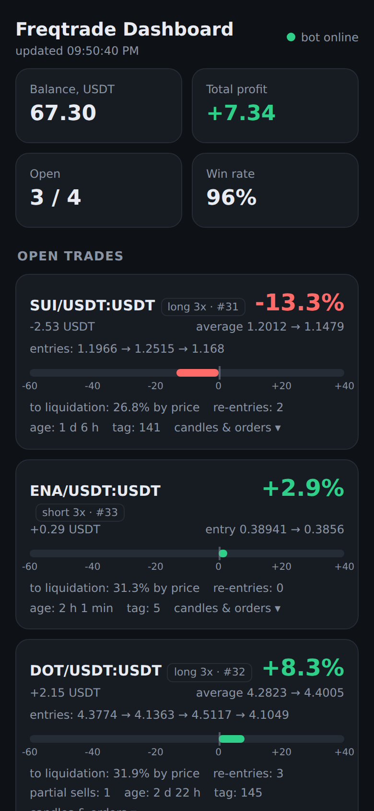
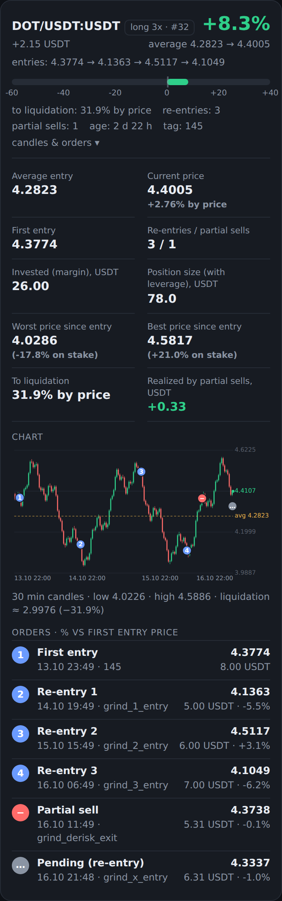
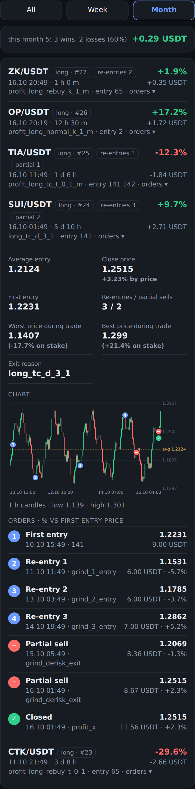

# Freqtrade Dashboard (русская версия)

[English version: README.md](README.md)

Небольшой веб-дашборд **только для просмотра** для бота [Freqtrade](https://www.freqtrade.io), чтобы удобно смотреть бота с телефона.
Один файл на Python (только стандартная библиотека) и одна HTML-страница. Без pip-пакетов и сборки, занимает около 10 МБ памяти.
Сделан для маленьких устройств (ТВ-приставки, Raspberry Pi, старые телефоны), работает везде, где есть Python 3.8+.

Дашборд никогда не отправляет команды боту: он только читает данные из REST API Freqtrade.

<p>



</p>

*На скриншотах демо-данные, а не реальные сделки.*

## Что показывает

- Баланс, общая прибыль, занятые слоты, винрейт.
- **Открытые сделки**: прибыль в % и USDT, средняя цена входа, текущая цена, список цен входа
  (`entries: 1.19 → 1.24 → 1.16`), расстояние до ликвидации (фьючерсы), число докупок и частичных продаж, возраст, тег входа.
- **Нажми на открытую сделку**, чтобы увидеть детали: первый вход, вложенную маржу, размер позиции с плечом, худшую и лучшую цену с момента входа
  (и сколько это в % на твою ставку), прибыль, уже зафиксированную частичными продажами, и **свечной график** (OHLC):
  - линия средней цены входа и линия цены ликвидации;
  - пронумерованные маркеры каждого входа и докупки (1, 2, 3 …), красный минус на каждой частичной продаже, серая точка у ордера, который ещё не исполнен;
  - список всех ордеров: время, тег ордера, цена, размер в USDT и отклонение в % от цены первого входа.
  - **Управление графиком**: размер свечи Auto, 15 min или 1 hour, а кнопка **◀ +7d** подгружает ещё неделю истории до сделки (нажимай ещё раз, чтобы уйти глубже, ↺ сбрасывает).
- **Закрытые сделки**: сворачиваемый список до 300 сделок с фильтрами **Все / Неделя / Месяц**, итоговая строка (в плюс, в минус, сумма в USDT),
  значки с количеством докупок и частичных продаж. По нажатию на сделку открываются те же детали, свечной график и список ордеров
  (с галочкой на итоговом закрытии).
- График прибыли по дням (последние 14 дней) и итоги.
- Состояние хоста: статус сервиса бота, перезапуски, свободная память, своп, загрузка CPU, температура, диск, аптайм.

Работает с фьючерсами и спотом. Свечи берутся из публичных данных Binance (ключ не нужен); шаг свечей подбирается
по возрасту сделки (5 мин, 15 мин, 30 мин, 1 ч … 1 д). Светлая и тёмная тема следуют настройке системы. Сделан под экран телефона.

## Требования

- Работающий бот Freqtrade с включённым REST API.
- Python 3.8+ на машине, где запускается дашборд (обычно та же, что и бот).
- Любая ОС для самого дашборда (Linux, Windows, macOS, см. раздел 5). Linux нужен только для блока состояния хоста, на других системах он показывает прочерки.

## 1. Включи API Freqtrade

В `config.json` бота (см. документацию Freqtrade, раздел «REST API»):

```json
"api_server": {
    "enabled": true,
    "listen_ip_address": "127.0.0.1",
    "listen_port": 8080,
    "username": "your_user",
    "password": "a_long_random_password",
    "jwt_secret_key": "something_random",
    "CORS_origins": []
}
```

После изменения конфига перезапусти бота. Оставь `listen_ip_address` равным `127.0.0.1`, если дашборд работает на той же машине.

## 2. Установка и запуск

```bash
mkdir -p ~/freqtrade-dashboard && cd ~/freqtrade-dashboard
# положи сюда server.py и index.html
python3 server.py
```

Открой `http://127.0.0.1:8090` на этой машине. По умолчанию дашборд берёт адрес API и
логин с паролем из `~/freqtrade/user_data/config.json`. Если конфиг лежит в другом месте или ты не хочешь,
чтобы дашборд читал файл с ключами биржи, передай настройки API через переменные окружения:

```bash
FT_API_URL=http://127.0.0.1:8080 FT_API_USER=your_user FT_API_PASS='a_long_random_password' python3 server.py
```

## 3. Открыть с телефона (домашняя сеть)

По умолчанию дашборд слушает только `127.0.0.1`. Чтобы открыть его с другого устройства в домашней сети:

```bash
DASH_HOST=0.0.0.0 DASH_PASS='придумай-пароль' python3 server.py
```

Затем открой `http://<ip-коробки>:8090` и войди (пользователь `admin` или свой через `DASH_USER`).

### Безопасность, прочитай обязательно

- Страница показывает твой баланс и позиции. **Не выставляй её в интернет** (никакого проброса портов).
- Пользуйся только в домашней сети или через VPN (Tailscale/WireGuard) либо SSH-туннель:
  `ssh -L 8090:127.0.0.1:8090 user@box`, затем открой `http://127.0.0.1:8090`.
- Всегда задавай `DASH_PASS`, если используешь `DASH_HOST=0.0.0.0`. Basic-авторизация по обычному HTTP годится только в доверенной сети.
- В дашборде нет кнопок, он не умеет торговать, останавливать или перезапускать бота.
- Запрос графика отвечает только для пар, которые есть в твоих открытых или закрытых сделках.

## 4. Запуск как сервис (systemd)

Создай `/etc/systemd/system/freqtrade-dashboard.service` (поменяй пользователя и пути):

```ini
[Unit]
Description=Freqtrade Dashboard
After=network-online.target

[Service]
User=YOUR_USER
WorkingDirectory=/home/YOUR_USER/freqtrade-dashboard
Environment=DASH_HOST=0.0.0.0
Environment=DASH_PASS=придумай-пароль
Environment=FT_CONFIG=/home/YOUR_USER/freqtrade/user_data/config.json
ExecStart=/usr/bin/python3 /home/YOUR_USER/freqtrade-dashboard/server.py
Restart=always
MemoryMax=80M

[Install]
WantedBy=multi-user.target
```

```bash
sudo systemctl daemon-reload
sudo systemctl enable --now freqtrade-dashboard
sudo systemctl status freqtrade-dashboard
```

Если сервис твоего бота называется иначе, добавь `Environment=FT_SERVICE=имя`, чтобы поля «Сервис бота» и «Перезапуски» работали.

## 5. Windows, macOS и Docker

Сам дашборд (сделки, ордера, свечи, история, прибыль по дням) работает на любой системе с Python 3.8+.
Только блок «Бот и коробка» читает файлы Linux (`/proc`, `/sys`, `systemctl`); на Windows и macOS он просто покажет прочерки.
В этих системах передавай настройки API переменными окружения (стандартный путь к конфигу это путь Linux).

### Windows

1. Установи Python 3 с [python.org](https://www.python.org/downloads/) (поставь галочку **Add python.exe to PATH**).
2. Положи `server.py` и `index.html` в папку, например `C:\freqtrade-dashboard`.
3. Открой PowerShell в этой папке и выполни:

```powershell
$env:FT_API_URL="http://127.0.0.1:8080"
$env:FT_API_USER="your_user"
$env:FT_API_PASS="a_long_random_password"
python server.py
```

Открой `http://127.0.0.1:8090`. Чтобы открыть с телефона в той же сети, добавь перед `python server.py` строки `$env:DASH_HOST="0.0.0.0"` и
`$env:DASH_PASS="придумай-пароль"` и разреши Python в брандмауэре Windows только для **частных** сетей.

Для автозапуска сохрани текст ниже как `start.bat` в той же папке и добавь его в Планировщик заданий («При входе в систему»):

```bat
@echo off
cd /d %~dp0
set FT_API_URL=http://127.0.0.1:8080
set FT_API_USER=your_user
set FT_API_PASS=a_long_random_password
python server.py
```

### macOS

Python 3 входит в инструменты командной строки Xcode (`python3 --version`), либо поставь его командой `brew install python`.

```bash
cd ~/freqtrade-dashboard
FT_API_URL=http://127.0.0.1:8080 FT_API_USER=your_user FT_API_PASS='a_long_random_password' python3 server.py
```

Чтобы запускать при входе в систему, создай `~/Library/LaunchAgents/com.freqtrade.dashboard.plist` (путь к Python возьми из `which python3`, остальные пути свои):

```xml
<?xml version="1.0" encoding="UTF-8"?>
<!DOCTYPE plist PUBLIC "-//Apple//DTD PLIST 1.0//EN" "http://www.apple.com/DTDs/PropertyList-1.0.dtd">
<plist version="1.0"><dict>
  <key>Label</key><string>com.freqtrade.dashboard</string>
  <key>ProgramArguments</key><array>
    <string>/usr/bin/python3</string>
    <string>/Users/YOU/freqtrade-dashboard/server.py</string>
  </array>
  <key>EnvironmentVariables</key><dict>
    <key>FT_API_URL</key><string>http://127.0.0.1:8080</string>
    <key>FT_API_USER</key><string>your_user</string>
    <key>FT_API_PASS</key><string>a_long_random_password</string>
  </dict>
  <key>RunAtLoad</key><true/>
  <key>KeepAlive</key><true/>
</dict></plist>
```

Затем выполни `launchctl load ~/Library/LaunchAgents/com.freqtrade.dashboard.plist`.

### Freqtrade в Docker

Внутри контейнера API должен слушать все интерфейсы, но порт нужно пробросить только на loopback хоста, чтобы снаружи он был недоступен.
В `config.json` Freqtrade укажи `"listen_ip_address": "0.0.0.0"`, а в `docker-compose.yml`:

```yaml
    ports:
      - "127.0.0.1:8080:8080"
```

Затем запусти дашборд на хосте с `FT_API_URL=http://127.0.0.1:8080` и логином и паролем API (см. выше).
Если дашборд запущен вторым контейнером в той же сети compose, используй `FT_API_URL=http://freqtrade:8080` (имя твоего сервиса).
Блок хоста тогда покажет машину, где работает дашборд, а не контейнер бота.

*Шаги для Windows, macOS и Docker написаны по стандартному поведению этих систем. Код дашборда проверен на Linux, а также в имитации среды без файлов Linux (нет `/proc`, `/sys`, `systemctl`).*

## Настройки (переменные окружения)

| Переменная | По умолчанию | Значение |
|---|---|---|
| `DASH_HOST` | `127.0.0.1` | Адрес, на котором слушать (`0.0.0.0` = все интерфейсы) |
| `DASH_PORT` | `8090` | Порт |
| `DASH_USER` / `DASH_PASS` | `admin` / пусто | Basic-авторизация самого дашборда (выключена, если `DASH_PASS` пустой) |
| `FT_CONFIG` | `~/freqtrade/user_data/config.json` | Конфиг Freqtrade с разделом `api_server` |
| `FT_API_URL`, `FT_API_USER`, `FT_API_PASS` | пусто | Использовать вместо чтения конфига |
| `FT_SERVICE` | `freqtrade` | Имя systemd-юнита бота (для статуса и числа перезапусков) |
| `DASH_BINANCE_FUTURES`, `DASH_BINANCE_SPOT` | публичные адреса Binance | Источник свечей |

## Как показаны докупки и частичные продажи

Дашборд читает список `orders`, который API Freqtrade отдаёт по каждой сделке.
Первый исполненный ордер на вход называется «First entry» (первый вход), следующие ордера на вход «Re-entry 1, 2, 3 …»
(докупки, усреднения, grinding, DCA), ордера на выход перед последним «Partial sell» (частичная продажа),
а последний ордер на выход у закрытой сделки «Closed» (закрытие).
Теги ордеров (например `grind_1_entry` в NostalgiaForInfinity) показываются так, как их присылает бот.
Процент рядом с ордером это изменение цены относительно цены первого входа, а не твоя прибыль.
Проценты «on stake» («на ставку») это движение цены, умноженное на плечо, считая от средней цены входа.
Худшая и лучшая цены берутся из min/max rate, которые Freqtrade отслеживает, пока сделка открыта, поэтому точность зависит от интервала цикла бота.

## Обновление и удаление

Обновление: замени `server.py` и `index.html`, затем `sudo systemctl restart freqtrade-dashboard`.
Удаление: `sudo systemctl disable --now freqtrade-dashboard`, удали файл юнита и папку.

## Если что-то не работает

- **«bot API unreachable»**: дашборд не может достучаться до API Freqtrade. Проверь, что `api_server` включён, порт верный,
  а логин и пароль совпадают. Проверка: `curl -u your_user:password http://127.0.0.1:8080/api/v1/ping`.
- **Нет графика у сделки**: для свечей нужен доступ в интернет к публичным данным Binance; пары должны быть `XXX/USDT` или `XXX/USDT:USDT`.
  Если сделки на другой бирже, список ордеров всё равно работает, не будет только свечного графика (или он будет неверным).
- **Нет ордеров у сделки**: у очень старых сделок, импортированных из других источников, в базе Freqtrade может не быть истории ордеров.
- **Пустые поля памяти и температуры**: блок хоста читает `/proc` и `/sys`, поэтому нужен Linux.

## Примечания

- Неофициальный инструмент сообщества, не связан с Freqtrade и NostalgiaForInfinity. Он только читает данные из API твоего бота и ничего в нём не меняет.
- Проверено на Freqtrade 2026.10-dev под Armbian (Python 3) с ботом NostalgiaForInfinityX8 на Binance USDⓈ-M фьючерсах. Предоставляется как есть, без гарантий. Не является финансовой рекомендацией.
- Лицензия: MIT (см. `LICENSE`). Замечания и pull request приветствуются.
